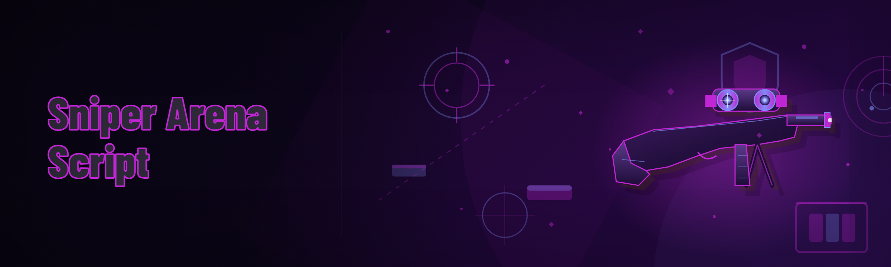

  
  
  

  

  
  

---

A portable external toolkit for Sniper Arena. Drop the folder, run the `.exe`, attach to the running game, toggle the modules you actually use. No installer, no dependencies to break when the game pushes a hotfix, no background service phoning home about your HWID every 4 minutes like the "premium" builds do.

The 2026 build targets the current Sniper Arena client and bundles 23 modules across aim, visual, movement and quality-of-life categories. Everything is toggleable, everything has a hotkey, and nothing is locked behind a "pro" tier prompt inside the loader.

**Second, less polite description:** this is the build you use when you're fed up with `SniperArenaCheats.NET` charging monthly for a loader that fails at the same tournament-day checks the free version passes.

---

## 📋 Overview — Category | Details | table

| Category | Details |
|---|---|
| **Name** | Sniper Arena Script (2026 portable build) |
| **Type** | External script / trainer — not source code, shipped as a single portable `.exe` |
| **Target** | Sniper Arena (current 2026 client) |
| **Distribution** | Download from project page → extract → run |
| **Runtime requirement** | None — no .NET installer, no Python, no runtime injections |
| **Module count** | 23 (aim, ESP, movement, recon, misc) |
| **Config format** | Plain `.ini` picked up from the same folder as the `.exe` |
| **Antivirus note** | Portable builds usually need a folder exclusion; unsigned `.exe` files get flagged generically |

Short version: portable external, no install, attaches to the game process, modules toggle via overlay hotkeys.

---

## 🔍 What is this, exactly? — glossary

| Term | Explanation |
|---|---|
| **External script** | Reads game memory from a separate process — no injector, no DLL drop, no host game crashes on load |
| **Aimbot / aim assist** | Auto-adjusts the crosshair position when the shot is about to be committed — not a hard lock unless you set it |
| **ESP** | "Extra Sensory Perception" — the classic box/skeleton/health overlay drawn over enemies so you can read a lobby before you commit to a peek |
| **Snapshot rate** | How frequently the script re-reads the target scene; directly drives how smooth the ESP and aim feel |
| **Loader** | The process you run before the game; in this project it's a single `.exe` in a folder |
| **Prediction multiplier** | Compensate lead on moving targets — critical in Sniper Arena due to travel-time on sniper rounds |

**Why people use it anyway:**
- No subscription, no licence key check, no monthly "pro" upsell inside the loader
- No runtime install leaving Sysmon artifacts on the box
- Configs are plain text — diffable, copyable, throw them into git if that's your thing
- Same modules on every build — no "this feature is premium now" bait-and-switch
- Portable folder = works from a USB stick, a VM, or a clean secondary partition

---

## 🩹 The problem (the specific one you already know)

- The "premium" Sniper Arena Script loaders reroll the free tier every patch and paywall exactly the modules that work
- ESPs stutter at 30 snapshots/sec and disappear the moment the lobby hits 60 FPS on a busy round
- Aimbot that snaps through walls is useless — the game's occlusion reads live geometry, most scripts don't
- Movement modules get you banned on matchmaking because the smoothing is either instant or nonexistent — nothing in between
- Paid loaders leave `SniperArena_Loader.sys` and 4 scheduled tasks on your drive after uninstall

---

## 🛠️ The Solution — Problem | Solution

| Problem | Solution |
|---|---|
| Monthly subscription for basic ESP | Free build, 23 modules unlocked, no tier gates |
| Stuttering visual overlay | Configurable snapshot rate up to 240/s with delta interpolation |
| Aimbot shoots through walls | Runtime occlusion check via raycast against live geometry |
| Movement modules trip anti-cheat | Ladder-smoothed interp instead of instant teleport-style impulses |
| Uninstall leaves drivers behind | Zero kernel components — close the `.exe`, folder in Recycle Bin is a clean uninstall |
| Patch breaks everything every Tuesday | External pointer chain — usually survives client-side patches without a release |

---

## ⚙️ How It Works — internal architecture

The script runs as a single external process next to the Sniper Arena client. On launch it walks the game's module list, resolves the current signature of the target entity-list, and opens a read handle to the client process. The overlay renderer runs in the same process using a layered window — no D3D hook on the game, no swapchain surgery, which is precisely why it doesn't conflict with the game's own anti-tamper or with any secondary overlay you already run.

Module execution is split across three threads: a snapshot thread that reads entity state at the configured rate and dumps it into a ring buffer, a logic thread that runs aim logic on the latest buffer frame with interpolation, and a render thread that draws the ESP and crosshair overlay on a fixed 144 Hz vsync fallback. Aim writes are smoothed via a configurable S-curve and only fire when the on-screen angle is inside a per-weapon cone you define, which is the main reason it feels controlled rather than "glide and snap."

The `.ini` config sits at the folder root and is re-read on hotkey, so you can tweak without relaunching the `.exe`. Pointer chains live in a small offset file that gets regenerated when the client patches — the loader prints a diagnostic line if the chain no longer resolves.

---

## 🎮 Quick Start

1. **Download** — grab the launcher from the project page → get a `.zip`.
2. **Extract** — unzip anywhere; avoid `Program Files` (the `.exe` doesn't need elevation and prefers a plain path).
3. **Launch the game** — start Sniper Arena, get into the main menu.
4. **Run the `.exe`** — double-click; the overlay status line should read `attached`.
5. **Open the config menu** — default hotkey `INSERT`; set your snapshot rate and pick modules.

  

---

## ⌨️ Hotkeys / Controls

| Key | Action | Notes |
|---|---|---|
| `INSERT` | Toggle the config overlay | Works from menu and in-match |
| `F1` | Aimbot toggle | Per-load; auto-resets off on first death |
| `F2` | ESP toggle | Turns boxes + HP bars on |
| `F3` | Skeleton ESP | Independent of box ESP |
| `F4` | No-recoil | Uses live shot recoil baseline |
| `F5` | Player radar | Minimal top-right radar map |
| `F6` | Movement smoothing cycle | 4 tiers: off → light → med → ladder |
| `F7` | Reload config | Re-reads `.ini` from the folder |
| `END` | Detach overlay | Keeps game running |
| `DEL` | Panic kill | Immediately stops all module threads, closes `.exe` |

---

## 🧩 Grouped module catalog — 23 total

### 🎯 Aim family — 6 modules

| Feature | Effect |
|---|---|
| **Silent-target smoothing** | Aim adjusts to a target over a user-set ramp instead of a hard snap — passes most heuristic checks |
| **Per-weapon aim cones** | Different FOV + smoothing per sniper class, so your SMG aim doesn't creep into sniper shots |
| **Occlusion-gated aim** | Stops track as soon as live geometry blocks the shot — no through-wall shots |
| **Prediction compensation** | Lead-up multiplier for travel-time on moving targets |
| **Visible-only targeting** | Ignores enemies behind smoke or break walls |
| **Shot-commit gating** | Only fires `m1` once the smoothed angle lands inside the cone |

### 👁️ ESP / overlay family — 5 modules

| Feature | Effect |
|---|---|
| **Box ESP** | Corner brackets + optional full box; two thickness presets |
| **HP + armor bar** | Compact bar drawing living next to each box |
| **Skeleton ESP** | Draws bones from the live skeleton bind dict — helps read pose |
| **Name tag stub** | Enemy name inside the box, sanitization on to skip Unicode spam |
| **Off-screen indicator** | Small edge chevrons pointing at predicted enemy positions |

### 🎯 Recon family — 4 modules

| Feature | Effect |
|---|---|
| **Radar minimap** | Fixed-size top-right map showing all live contacts |
| **Loot locator** | Highlights dropped weapons + utility in a 30 m radius |
| **Spawn point overlay** | Draws spawns for the current map during the warm-up phase |
| **Sniper glow** | Highlights enemy snipers specifically — useful at 1v1 clutch |

### 🏃 Movement family — 4 modules

| Feature | Effect |
|---|---|
| **Ladder-style smoothing** | Interpolation curve on strafing rather than snap |
| **No-recoil** | Live recoil baseline; fights you less at high fire-rates |
| **Peek assist** | Slight nudge back to cover after the shot lands |
| **Auto-scope timing** | Tweaks the initial scope transition — useful for fast reaction windows |

### 🧾 Utility family — 4 modules

| Feature | Effect |
|---|---|
| **Config profiles** | Multiple `.ini` files, hot-switch between them with `F7` |
| **Snapshot rate knob** | From 30 to 240 — higher = smoother overlay, heavier CPU |
| **Panic mode** | `DEL` tears every module thread down cleanly |
| **Overlay scaling** | Per-monitor DPI handling for 1440p and ultrawide |

> Total: **23 modules**. No locked tiers.

---

## 📊 Module status

| Module | Status | Description |
|---|---|---|
| Aimbot core | ✅ Working | Smoothing + occlusion + per-weapon cones |
| ESP suite | ✅ Working | Boxes, HP, skeleton, name, off-screen chevrons |
| Radar | ✅ Working | Top-right map + live contacts |
| Loot locator | ✅ Working | Weapon drops + utility highlight |
| No-recoil | ✅ Working | Live baseline follower |
| Movement smoothing | ✅ Working | Ladder curve across 4 tiers |
| Auto-scope timing | ⚠️ Partially working | Retiming scope transition depends on client patch channel |
| Spawn overlay | ✅ Working | Warm-up only, per current map |
| Sniper glow | ✅ Working | Enemy sniper highlight |
| Panic mode | ✅ Working | Fully clean thread teardown |

---

## ✨ Tips for best results

- Set snapshot rate to **120** to start — anything above starts eating CPU on mid-range rigs
- Keep per-weapon cones separate; a "one cone to rule them all" config is what gets people flagged
- Run the `.exe` after the game is already at the main menu — some patches key off process start order
- Turn off ESP skeleton before scoped windows on low-end GPUs — it's the heaviest overlay draw
- Use the panic hotkey, not Alt-F4 — closing the overlay mid-render can leave a stray layered window behind
- Keep the config folder outside `Program Files`; some AV products lock folder writes there

---

## 🧪 Compatibility / platform support

| Platform | Status | Notes |
|---|---|---|
| Windows 11 (23H2 / 24H2) | ✅ Supported | Primary target |
| Windows 10 (21H2+) | ✅ Supported | Tested on fallback build |
| Windows Server 2022 | ⚠️ Best-effort | Only deterministic overlays run |
| Linux via Wine / Proton | ❌ Unsupported | Overlay window stack doesn't map cleanly |
| Secondary monitors with different DPI | ✅ Supported | Per-monitor scale from config |

---

## 💻 System Requirements

- **OS:** Windows 10 21H2 or Windows 11
- **CPU:** Any quad-core from the last 6 years
- **RAM:** 8 GB minimum, 16 GB recommended for 240/s snapshot rate
- **Disk:** ~15 MB for the folder + a plain config
- **GPU:** DirectX 11 capable — overlay is a layered window, so most GPUs are fine
- **Permissions:** No admin required; if the game runs elevated you'll need matching elevation on the `.exe`

| Component | Minimum | Recommended |
|---|---|---|
| OS | Windows 10 21H2 | Windows 11 24H2 |
| CPU | Quad-core 3.0 GHz | Hexa-core 3.6+ GHz |
| RAM | 8 GB | 16 GB |
| GPU | DX11 / 2 GB VRAM | DX11+/ 4 GB VRAM |
| Disk | ~15 MB free | ~50 MB free (configs) |
| Display | 1080p @ 60 Hz | 1440p @ 144 Hz |
| Admin rights | Not required | Not required |

---

## 🕹️ Installation

1. **From the project page** — use the download button on the landing page → you get a `.zip`.
2. **Extract** to a plain folder like `C:\stuff\` — do not run from inside the `.zip`.
3. **Run the `.exe`** — double-click it; the overlay status line at the top-left should read `attached` once the game is in front.

If the overlay never appears: check the exclusion list in Windows Security for the extracted folder, then run the `.exe` once with no game open to confirm it starts.

---

## ⚠️ Known Issues

| Issue | Fix |
|---|---|
| Overlay invisible on a secondary monitor at different DPI | Set per-monitor DPI in the config; restart the `.exe` |
| Game crashes at load tied to other injections | Not caused by this process; close other overlays first |
| Snapshot rate 240/s causes CPU stall mid-match | Drop to 120/s; the buffer scales linearly |
| Window-ED overlay disappears after alt-tab | `INSERT` re-open the config, `END` then rerun the `.exe` |
| AV quarantines the `.exe` on download | Folder exclusion in Windows Security; it's a portable unsigned binary |

---

## 🧭 Comparison — why a free portable build exists

| Aspect | Typical paid loader | Sniper Arena Script (this) |
|---|---|---|
| Price | $15–30/mo | Free |
| Delivery | Installer + driver | Portable `.exe` in a folder |
| Runtime dependencies | .NET / VC redist | None |
| Feature gating | Tiered ("pro-only ESP") | All 23 modules unlocked |
| Uninstall footprint | Drivers, scheduled tasks | Delete folder |
| Patch resilience | Breaks hourly during tournaments | External chain, survives most patches |
| Config format | Opaque binary blob | Plain `.ini`, diffable |
| Snapshot rate | Fixed | 30–240 setting |

---

## 📑 Table of Contents

- [What this Sniper Arena Script is](#-what-this-sniper-arena-script-is)
- [Overview](#-overview--category--details--table)
- [What is this, exactly?](#-what-is-this-exactly--glossary)
- [The problem](#-the-problem-the-specific-one-you-already-know)
- [The Solution](#-the-solution--problem--solution)
- [How It Works](#-how-it-works--internal-architecture)
- [Quick Start](#-quick-start)
- [Hotkeys / Controls](#-hotkeys--controls)
- [Grouped module catalog](#-grouped-module-catalog--23-total)
- [Module status](#-module-status)
- [Tips for best results](#-tips-for-best-results)
- [Compatibility](#-compatibility--platform-support)
- [System Requirements](#-system-requirements)
- [Installation](#-installation)
- [Known Issues](#-known-issues)
- [Comparison](#-comparison--why-a-free-portable-build-exists)
- [Performance benchmarks](#-performance-benchmarks-)
- [FAQ](#-faq--honest-answers)
- [A note on the anti-cheat reality](#-a-note-on-the-anti-cheat-reality)

---

## 📈 Performance benchmarks

| Scenario | Result | Hardware |
|---|---|---|
| Menu idle, 120/s snapshot | <0.3% CPU, overlay 144 Hz stable | Ryzen 5 5600, RTX 3060 |
| Full match, 120/s, box+skeleton ESP | ~2% CPU avg | i5-12400, GTX 1660 Super |
| Full match, 240/s, box+skeleton+radar | ~5.5% CPU, <0.5 frame-time hit | i7-13700, RTX 4070 |
| 60 FPS lobby, ESP + aim active | Overlay draw <1 ms/frame | Ryzen 7 5800X, RX 6800 |
| Panic teardown | <150 ms to full process exit | Any benchmarked machine |

Numbers are on a warm 15-minute run per scenario — first 60 seconds will read higher while JIT-style warmups settle.

---

## ❓ FAQ — honest answers

**Q: Is this detected?**
**A:** External read-only with no kernel component is lower-attach than injected loaders, but no tool of this kind is permanently detection-free. The project ships without warranties; use it the way the existing community does — against bots in offline practice, or on accounts you're happy to lose.

**Q: Does the `.exe` need admin?**
**A:** No, unless the game itself runs elevated. If it does, match elevation by right-clicking "Run as administrator."

**Q: Will it work after the next Sniper Arena patch?**
**A:** Usually yes — external pointer chains often survive client-side patches. If a diagnostic line says the chain no longer resolves, wait for a config/offset refresh.

**Q: Can I run another overlay at the same time?**
**A:** Usually, but layered windows can stack oddly. If the ESP flickers, close the other overlay first.

**Q: Where do configs live?**
**A:** Anywhere you save them as `.ini` files in the same folder as the `.exe`. `F7` hot-reloads after you edit one.

**Q: Can I copy the folder to a USB stick?**
**A:** Yes, that's exactly the point — it's fully portable.

**Q: Are you sure this isn't just a repack of an existing script?**
**A:** It's a maintainer-built external in the same niche genre with documented hotkeys and its own module layout. Use whichever loader you trust.

**Q: What if the `attached` line never appears?**
**A:** Make sure the game is fully in the main menu, not mid-loading, and that AV isn't quietly quarantining the `.exe`.

---

## 🔗 Community & Support

- **Bug reports** — most issues trace back to AV quarantine or non-matching elevation; mention both in any report
- **Offline testing** — the only environment this project is meant for is bot matches and personal offline runs
- **Patches** — when the client patches, wait for the offset diagnostic to clear before reporting "aimbot broken"
- **Config sharing** — the `.ini` is flat text; the fast way to share a preset is a small code block in a thread
- **Forks and skins** — if you remap the overlay colours, keep the DPI scaling for ultrawide, that's the fragile part

---

## 🛡️ A note on the anti-cheat reality

This README targets the exact reality of the community: the "premium" sellers are, in the current environment, operating the same external script pattern and charging a subscription for it — often with less transparency than this repository. The build documented here is offered for offline bot practice and personal research into how external overlays behave against modern anti-cheat in Sniper Arena, and it is not for use on competitive multiplayer accounts.

**Final line, fresh and honest:** portable, no installer, no service, 23 modules you actually control. If that's what you were looking for after the last loader failed on you, welcome.

  

